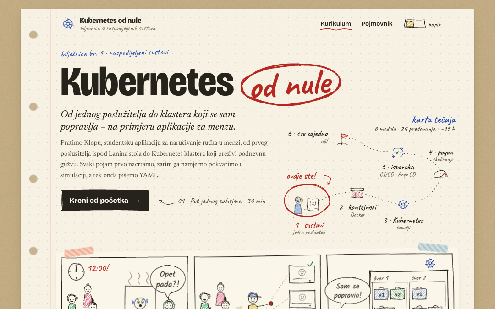
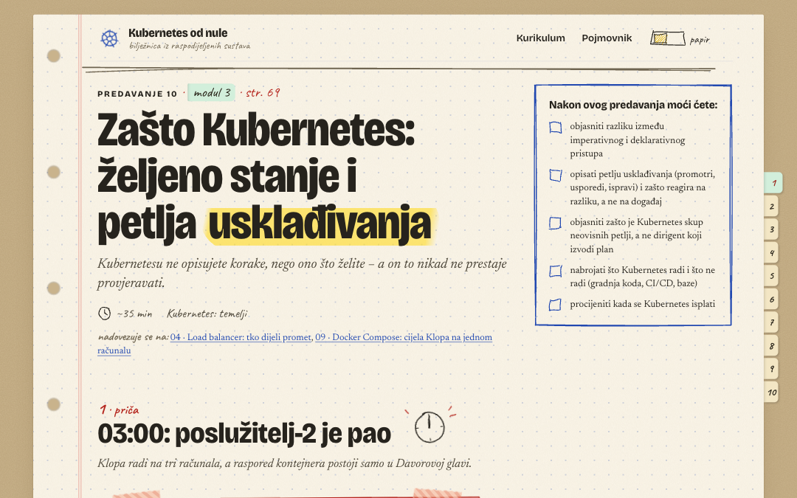
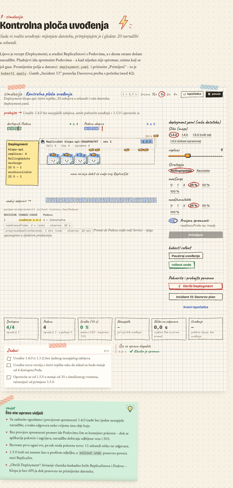
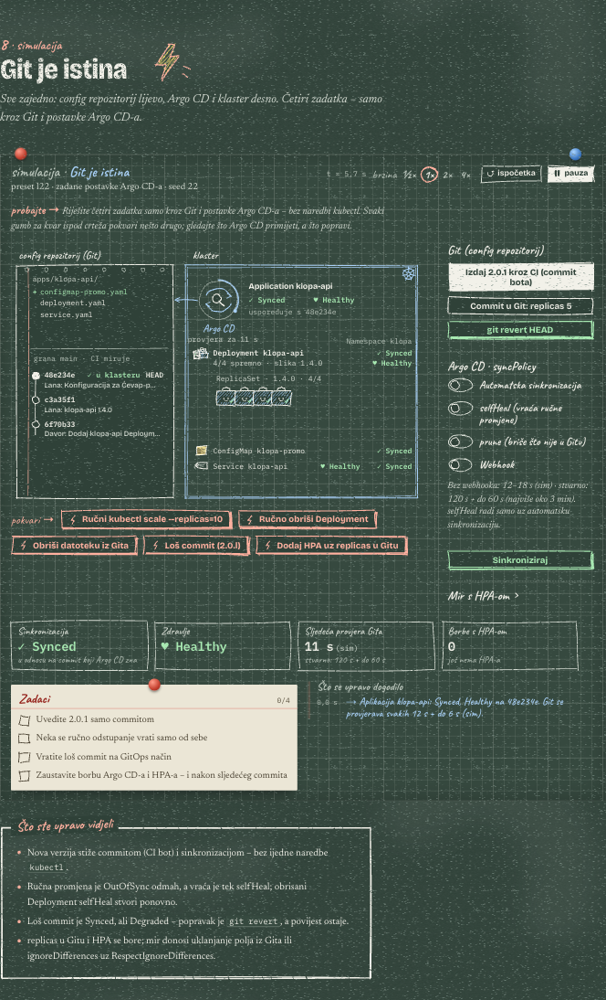

<p align="center">
  <a href="https://devop.blazperic.com"></a>
</p>

<h1 align="center">Kubernetes od nule</h1>

<p align="center">
  <em>Od jednog poslužitelja do klastera koji se sam popravlja – na primjeru aplikacije za menzu.</em>
</p>

<p align="center">
  <a href="https://devop.blazperic.com"><b>▶ Otvori tečaj: devop.blazperic.com</b></a>
</p>

<p align="center">
  24 predavanja · 6 modula · oko 15 sati · na hrvatskom · besplatno, bez prijave
</p>

<p align="center">
  <a href="https://devop.blazperic.com"></a>
</p>

---

## Za koga je ovo?

Za studente i programere koji **znaju programirati, ali nikad nisu pokretali poslužitelje, Docker ili Kubernetes**. Ne trebate ništa instalirati – sve radi u pregledniku.

Ako ste se ikad pitali:

- zašto aplikacija koja radi na `localhost` ne radi nikome drugome,
- zašto poslužitelj „pada” u podne iako mu procesor odmara,
- što zapravo radi Docker i zašto ga svi koriste,
- zašto Kubernetes postoji i što se dogodi nakon `kubectl apply`,
- kako nova verzija stigne od commita do korisnika bez da itko išta ruši,

…ovaj tečaj je za vas.

## Kako izgleda učenje

Cijeli tečaj prati **Klopu**, izmišljenu studentsku aplikaciju za naručivanje ručka u menzi. Počinje na Laninom laptopu, a završava u Kubernetes klasteru koji preživi podnevnu gužvu i „Ćevap-petak”. Svako predavanje počinje problemom koji je stvarno mogao nastati – i tek onda uvodi alat koji ga rješava.

Svaki pojam učimo istim redom:

1. **nacrtamo ga** – animacije i skice u stilu bilježnice,
2. **pokvarimo ga** – u simulaciji sami mijenjate postavke i namjerno izazivate kvarove,
3. **tek onda pišemo YAML** – kad već znate *zašto* nešto izgleda baš tako.

<p align="center">
  
</p>

### Simulacije koje možete pokvariti

U svakom predavanju je simulacija u kojoj vi vodite sustav: šaljete promet, gasite poslužitelje, uvodite novu verziju, radite loš commit. Brojke na ekranu nisu ukras – svaki incident iz priče možete ponoviti i popraviti sami.

<table>
  <tr>
    <td width="50%" valign="top">
      
      <p align="center"><sub><b>Deployment:</b> uvedite novu verziju bez ijedne izgubljene narudžbe – pa je namjerno pokvarite i vratite.</sub></p>
    </td>
    <td width="50%" valign="top">
      
      <p align="center"><sub><b>GitOps i Argo CD</b> (tamna tema „ploča”): sve promjene samo kroz Git, bez ijedne naredbe <code>kubectl</code>.</sub></p>
    </td>
  </tr>
</table>

### Još nekoliko sitnica

- **Pojmovnik** s 80-ak pojmova – hrvatski naziv, engleski izvornik i kratko objašnjenje.
- **Napredak se pamti** u vašem pregledniku; možete stati i nastaviti kad želite.
- **Dvije teme:** „papir” (svijetla) i „ploča” (tamna, kao školska ploča).
- Radi i na **mobitelu**.
- Činjenice o alatima provjerene su prema stanju u **2026.**

## Što ćete naučiti

| Modul | Predavanja |
|---|---|
| **1 · Zašto raspodijeljeni sustavi** | [Put jednog zahtjeva](https://devop.blazperic.com/predavanje/put-jednog-zahtjeva) · [Jedan poslužitelj u 12:00](https://devop.blazperic.com/predavanje/granice-jednog-posluzitelja) · [Zašto raspodijeljeni sustavi – i što to košta](https://devop.blazperic.com/predavanje/zasto-raspodijeljeni-sustavi) · [Load balancer](https://devop.blazperic.com/predavanje/load-balancer) · [Kad poslužitelj padne](https://devop.blazperic.com/predavanje/kad-posluzitelj-padne) · [Redovi poruka i događaji](https://devop.blazperic.com/predavanje/redovi-poruka) |
| **2 · Kontejneri** | [Virtualni stroj i kontejner](https://devop.blazperic.com/predavanje/virtualni-stroj-i-kontejner) · [Docker: od Dockerfilea do kontejnera](https://devop.blazperic.com/predavanje/docker) · [Docker Compose](https://devop.blazperic.com/predavanje/docker-compose) |
| **3 · Kubernetes: temelji** | [Zašto Kubernetes](https://devop.blazperic.com/predavanje/zasto-kubernetes) · [Klaster iznutra](https://devop.blazperic.com/predavanje/klaster-iznutra) · [Pod](https://devop.blazperic.com/predavanje/pod) · [Deployment](https://devop.blazperic.com/predavanje/deployment) · [Service](https://devop.blazperic.com/predavanje/service) · [Gateway API](https://devop.blazperic.com/predavanje/gateway-api) |
| **4 · Kubernetes u pogonu** | [ConfigMap i Secret](https://devop.blazperic.com/predavanje/configmap-i-secret) · [Resursi i raspoređivanje](https://devop.blazperic.com/predavanje/resursi-i-rasporedivanje) · [Automatsko skaliranje](https://devop.blazperic.com/predavanje/autoskaliranje) · [Volumeni i StatefulSet](https://devop.blazperic.com/predavanje/pohrana-i-statefulset) |
| **5 · Isporuka softvera** | [Što je deploy](https://devop.blazperic.com/predavanje/sto-je-deployment) · [CI/CD](https://devop.blazperic.com/predavanje/ci-cd) · [GitOps i Argo CD](https://devop.blazperic.com/predavanje/gitops-argo-cd) · [Tajne u GitOpsu](https://devop.blazperic.com/predavanje/tajne-u-gitopsu) |
| **6 · Sve zajedno** | [Dan izdanja: put jednog commita i jednog zahtjeva](https://devop.blazperic.com/predavanje/dan-izdanja) |

Predavanja se nadovezuju jedno na drugo, pa je najlakše krenuti [od početka](https://devop.blazperic.com/predavanje/put-jednog-zahtjeva). Svako traje 30–45 minuta.

## In English

**Kubernetes od nule** ("Kubernetes from scratch") is a free, interactive course in **Croatian** that takes programmers from a single server to a self-healing Kubernetes cluster: distributed systems basics, Docker, Kubernetes, CI/CD and GitOps. Every concept is first drawn, then broken on purpose in an in-browser simulation, and only then written as YAML. Start at **[devop.blazperic.com](https://devop.blazperic.com)**.

## Pronašli ste grešku?

Ako je nešto netočno, nejasno ili se simulacija ponaša čudno, [otvorite issue](https://github.com/Blazp04/devops/issues) – po mogućnosti s brojem predavanja i snimkom zaslona.

<details>
<summary><b>Pokretanje na vlastitom računalu</b></summary>

<br />

Potreban je Node.js 22 (ili 20.19+).

```bash
git clone https://github.com/Blazp04/devops.git
cd devops
npm install
npm run dev
```

Tečaj se otvara na http://localhost:5173. Za pisanje novih predavanja pogledajte [docs/AUTHORING.md](docs/AUTHORING.md).

</details>
